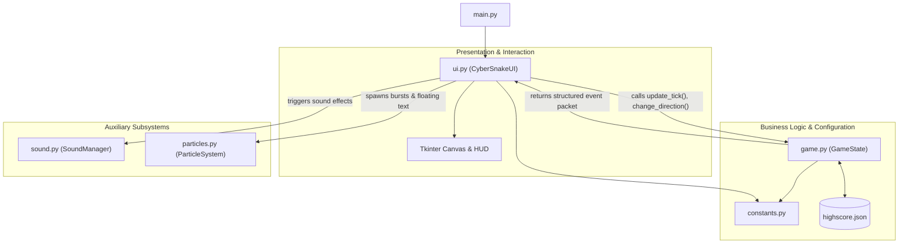

# AGENTS.md — CyberSnake: Neon Blitz Project Guide & Agent Instructions

This document provides project context, architecture, operational guides, dependencies, conventions, and modification instructions for any developer or AI assistant working in this repository.

---

## 1. Project Context & Overview

**CyberSnake: Neon Blitz** is a modern, high-framerate, vibrant neon/cyberpunk arcade snake game built in pure Python 3 using Tkinter. The project was designed from the ground up to have **zero third-party dependencies** (`pip install` is never required), running out-of-the-box on standard Python 3 installations.

### Core Highlights
- **Engine & Presentation**: Model-View-Controller (MVC) pattern decoupling pure logic (`game.py`) from GUI rendering (`ui.py`).
- **Dynamic Arcade Gameplay**:
  - Regular apples (+10 pts) and random timed power-ups (Golden Star, Speed Surge, Chill Freeze, Tail Trimmer).
  - Rapid-eat Combo multiplier system (`x2`, `x3`, etc.).
  - 3 Difficulty settings: *Casual* (wrap-around walls, relaxed speed), *Classic* (solid walls, standard pace), *Insane* (solid walls, hyper velocity).
  - Anti-suicide direction input buffering (prevents instant self-collisions on rapid key sequences).
- **Visuals & Aesthetics**:
  - Dark cyberpunk aesthetic with neon glowing borders, smooth color gradient snake interpolation, and directional eye tracking.
  - 2D particle physics engine for radial food bursts and floating upward score/combo indicators.
- **Audio Synthesis**:
  - Non-blocking asynchronous 8-bit retro chiptune sound generation using Windows `winsound.Beep` dispatched onto daemon background threads. Graceful silent fallback on non-Windows platforms.
- **Persistence**:
  - Persistent high-score tracking stored in `highscore.json`.

---

## 2. Project Structure & Architecture

```
Gemini Course/
├── main.py              # Application entry point & Tkinter window bootstrap
├── constants.py         # Single source of truth configuration (grid, colors, rules, timings)
├── game.py              # Core game engine & state machine (GameState) - zero GUI imports
├── ui.py                # Tkinter GUI, Canvas renderer, HUD, event handler & input binder
├── sound.py             # Asynchronous chiptune audio synthesizer (daemon threads)
├── particles.py         # Decoupled 2D particle spark physics & floating text popups
├── highscore.json       # Persistent JSON store for all-time high score
├── run.bat              # 1-click Windows desktop batch launcher
├── README.md            # User-facing game documentation & quick-start guide
├── PROJECT_ANALYSIS.md  # In-depth architectural & algorithmic evaluation
└── GEMINI.md            # Agent instructions & repository knowledge base (this file)
```

### Component Architecture & Data Flow



### Key Modules & Responsibilities
- **`main.py`**: Initializes `tk.Tk()`, sets up `CyberSnakeUI`, triggers initial render pass, and enters `mainloop()`.
- **`constants.py`**: Grid dimensions (`GRID_SIZE = 24`, `CELL_SIZE = 25`), neon hex colors, point values, combo bonuses, difficulty presets, and power-up identifiers.
- **`game.py`**: Encapsulates `GameState`. Manages snake coordinates, movement vectors, food generation, power-up timers, collision detection, and score tracking. Returns event dictionaries on each tick.
- **`ui.py`**: Coordinates Tkinter widgets, header HUD, 3 timed loops (`_schedule_game_tick`, `_schedule_fx_tick`, `_schedule_blink_tick`), keyboard bindings, and modal overlays (Menu, Paused, Game Over).
- **`sound.py`**: Encapsulates `SoundManager`. Plays tone sequences asynchronously via daemon threads to prevent UI frame stutter.
- **`particles.py`**: Manages `Particle` physics (radial velocity, friction, decay) and `FloatingText` upward drift and expiry.
- **`highscore.json`**: Plain JSON file containing `{"high_score": <int>}`.

---

## 3. How to Run the Project

### Prerequisites
- Python 3.8+ (optimized and tested on Python 3.15).
- Standard library modules only (no `pip install` required).

### Execution Commands
- **Standard execution**:
  ```bash
  python main.py
  ```
- **Windows Python Launcher**:
  ```cmd
  py -3 main.py
  ```
- **1-Click Windows Launcher**:
  Double-click `run.bat` in the project root.

### Controls Reference
| Key | Action |
| :--- | :--- |
| `W` / `↑` | Move UP |
| `S` / `↓` | Move DOWN |
| `A` / `←` | Move LEFT |
| `D` / `→` | Move RIGHT |
| `Space` / `Enter` | Start game / Pause / Resume / Restart on Game Over |
| `P` | Toggle pause |
| `R` | Instant restart match |
| `M` | Toggle audio mute / unmute |
| `1` / `2` / `3` | Switch difficulty: [1] Casual, [2] Classic, [3] Insane |

---

## 4. Important Dependencies

The project strictly adheres to a **Zero External Dependencies** policy. Only Python Standard Library modules are used:

| Module | Purpose |
| :--- | :--- |
| `tkinter` / `tkinter.font` | Windowing, HUD frames, labels, Canvas graphics, keyboard event binding |
| `json` | Serializing and deserializing high score data in `highscore.json` |
| `os` | File existence checks and path validation |
| `sys` | Operating system platform checks (`sys.platform`) |
| `math` | Angle trigonometry (`math.cos`, `math.sin`) for particle radial bursts and sine-wave pulsing |
| `random` | Food coordinate generation, power-up type selection, particle scatter |
| `threading` | Daemon worker threads to run audio playback without blocking Tkinter UI |
| `winsound` | Windows hardware chiptune sound generation (`winsound.Beep`) |
| `typing` | Static type hints (`List`, `Tuple`, `Optional`, `Dict`) |

> [!WARNING]
> Do **NOT** install or add external package dependencies (such as `pygame`, `pillow`, `numpy`, or `customtkinter`) unless explicitly instructed by the user.

---

## 5. Coding Conventions & Style Guidelines

### 1. Separation of Concerns (Strict MVC)
- **Zero GUI in Logic**: `game.py` must never import `tkinter` or UI classes. It should be fully testable and runnable headlessly.
- **Event-Driven Communication**: Game state changes return a structured dictionary from `GameState.update_tick()`:
  ```python
  event = {
      "game_over": False,
      "eaten": TYPE_APPLE,          # or None / TYPE_*
      "points_earned": 15,
      "combo_active": True,
      "powerup_activated": None,    # or TYPE_*
      "pos": (x, y)
  }
  ```
  `ui.py` receives this dictionary in `_handle_game_event()` to trigger particle effects and sounds.

### 2. Configuration Centralization
- **No Magic Numbers or Strings**: All colors, dimensions, point values, tick rates, and string constants belong in `constants.py`.
- **Derived Dimensions**: Dimensions should derive from `GRID_SIZE` and `CELL_SIZE` (`BOARD_WIDTH = GRID_SIZE * CELL_SIZE`).

### 3. Asynchronous Audio & Thread Safety
- Any audio synthesis must run on daemon threads (`threading.Thread(target=..., daemon=True).start()`).
- Audio calls must gracefully catch exceptions (e.g. device busy or audio hardware error) without crashing.
- On non-Windows platforms, audio methods must exit silently without raising errors.

### 4. Code Formatting & Quality
- **Python Standard**: Follow PEP 8 (4 spaces per indentation level, snake_case for functions/methods/variables, PascalCase for classes, UPPER_CASE for constants).
- **Type Annotations**: Provide type hints on method signatures and coordinate structures (`Tuple[int, int]`, `List[Tuple[int, int]]`).
- **Defensive File I/O**: High score reading and writing must always be wrapped in `try/except` blocks to prevent game crashes from missing or corrupted JSON files.
- **Clean Canvas Tagging**: When animating dynamic elements (like particles), use canvas tags (`tags="fx"`) and delete by tag (`self.canvas.delete("fx")`) rather than re-rendering the entire canvas unnecessarily.

---

## 6. Instructions for Modifying the Project

When prompted to modify or expand the project, follow these instructions:

### A. Adding a New Food or Power-Up Item
1. **Register Constant**:
   - In `constants.py`, add `TYPE_<NAME> = "<name>"`.
   - Add a corresponding neon color `COLOR_POWERUP_<NAME> = "#..."`.
   - If it awards points, define `POINTS_<NAME> = ...`.
2. **Implement Logic**:
   - In `game.py` (`GameState.try_spawn_special`), include the new type in `types` and assign appropriate probability weights in `weights`.
   - In `GameState.update_tick()`, handle collision with `self.special_food` when `sp_type == TYPE_<NAME>`. Apply buffs or state modifications (e.g. adjusting timers or snake segments).
   - Set `event["powerup_activated"] = TYPE_<NAME>`.
3. **Add Presentation & FX**:
   - In `ui.py` (`_draw_food`), add a drawing branch for the new power-up type using Tkinter shapes and Unicode glyphs/text.
   - In `_handle_game_event()`, add handling for `event["powerup_activated"] == TYPE_<NAME>`: trigger sound and spawn burst particles + floating popup text.
4. **Add Sound Effect**:
   - In `sound.py`, add a new method `play_<name>()` defining a retro frequency sequence `[(freq, duration), ...]`.

### B. Adjusting Game Speed, Board Size, or Difficulties
- Modify values only in `constants.py`.
- If modifying `GRID_SIZE` or `CELL_SIZE`, ensure `BOARD_WIDTH` and `BOARD_HEIGHT` calculate cleanly.
- If adjusting difficulty profiles, update `DIFFICULTIES` dictionary in `constants.py`.

### C. Adding Obstacles or Hazards
- Store obstacle coordinates in `GameState` (e.g. `self.obstacles: Set[Tuple[int, int]]`).
- Ensure `get_empty_positions()` filters out obstacle coordinates to prevent food spawning on hazards.
- Check collision in `GameState.update_tick()` prior to moving snake head.
- Draw obstacles in `ui.py` with distinct neon boundary styling.

### D. Extending Persistent Leaderboard
- Keep `highscore.json` backward-compatible. If migrating from a single integer `{"high_score": 0}` to an array of scores (e.g. `{"high_scores": [{"name": "...", "score": ...}]}`), maintain a fallback parser for the legacy integer format.

### E. Quality Assurance & Verification
- Test modifications for syntax errors before finalizing changes.
- Ensure the game starts cleanly from `main.py` without Tkinter geometry or threading errors.
- Ensure all loops (`_schedule_game_tick`, `_schedule_fx_tick`, `_schedule_blink_tick`) maintain their proper cadences without recursive stack buildup.
