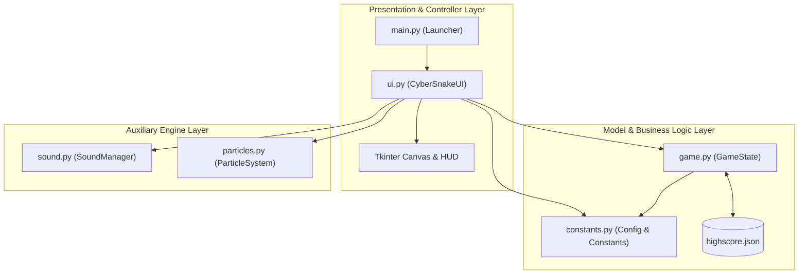
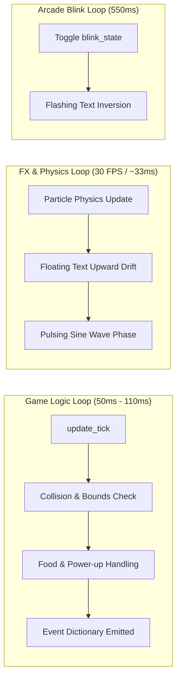
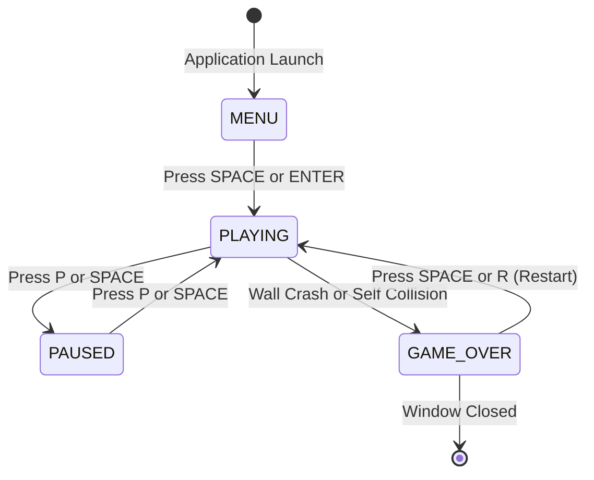

# 📊 CyberSnake: Neon Blitz — In-Depth Project Analysis

An architectural, algorithmic, and engineering evaluation of **CyberSnake: Neon Blitz**, a zero-dependency retro-arcade game developed in Python 3.

---

## 1. Executive Summary

| Attribute | Specification |
| :--- | :--- |
| **Project Name** | CyberSnake: Neon Blitz |
| **Language & Runtime** | Python 3.15+ (Compatible with Python 3.8+) |
| **GUI Framework** | Tkinter (Python Standard Library) |
| **External Dependencies** | **0** (Zero external packages or C extensions required) |
| **Architecture Pattern** | Model-View-Controller (MVC) with Event-Driven Dispatch |
| **Target Platform** | Windows (Optimized with `winsound` audio & batch launcher) |
| **Persistence Layer** | JSON File I/O (`highscore.json`) |

---

## 2. System Architecture & Topology

The project enforces strict separation of concerns across logic, presentation, physics/effects, and audio synthesis.



### Component Breakdown

1. **Launcher (`main.py`)**: Minimal bootstrap orchestrator. Initializes the root `tk.Tk` container and binds the execution lifecycle.
2. **Central Configuration (`constants.py`)**: Holds single-source-of-truth configuration including board dimensions, difficulty profiles, neon color hex codes, and timing thresholds.
3. **Core Engine (`game.py`)**: Encapsulates pure game state (`GameState`), grid matrices, collision detection, movement vectors, power-up mechanics, and scoring algorithms. It does not import Tkinter.
4. **Renderer & Interaction (`ui.py`)**: Owns canvas drawing routines, directional eye tracking, color gradient interpolation, HUD labels, and keyboard dispatch.
5. **Particle FX Engine (`particles.py`)**: Decoupled 2D physics subsystem managing radial sparks and floating combo text with decay life-cycles.
6. **Audio Synthesizer (`sound.py`)**: Asynchronous chiptune generator utilizing non-blocking daemon threads over Windows `winsound.Beep`.

---

## 3. Game Loop & State Dynamics

The game runs three coordinated update loops at distinct frequencies to decouple game logic, fluid animations, and UI text blinking:



### Finite State Machine (FSM)



---

## 4. Algorithmic Highlights

### A. Anti-Suicide Direction Buffering
A notorious bug in standard snake games occurs when a user rapidly presses two directional keys (e.g., `DOWN` then `LEFT`) before the next tick executes, causing the snake to collapse directly into its own body. 

`GameState.change_direction()` solves this by queueing inputs into `next_direction` and checking against the inverse of `direction`:
```python
if (dx, dy) != (-current_dx, -current_dy):
    self.next_direction = (dx, dy)
```

### B. Event-Driven Return Signatures
Rather than tightly coupling UI audio and animation triggers inside the logic loop, `GameState.update_tick()` returns a structured event packet:
```python
event = {
    "game_over": False,
    "eaten": TYPE_APPLE,
    "points_earned": 15,
    "combo_active": True,
    "powerup_activated": None,
    "pos": (x, y)
}
```
`CyberSnakeUI._handle_game_event()` ingests this packet to trigger sound synthesis, score popups, and radial particles independently.

### C. Color Gradient Interpolation
The snake body dynamically interpolates between `COLOR_SNAKE_BODY_START` (`#06b6d4`) and `COLOR_SNAKE_BODY_END` (`#0284c7`) in RGB color space via linear interpolation:
$$C_{\text{final}} = C_1 + (C_2 - C_1) \times \left(\frac{i}{\text{length}}\right)$$
Implemented in `CyberSnakeUI._interpolate_color()`.

### D. Asynchronous Non-Blocking Chiptune Audio
Standard `winsound.Beep(frequency, duration)` is synchronous and halts the calling thread. If called on Tkinter's main thread, frame rates stutter significantly.
`SoundManager._play_async()` spins off daemon worker threads to stream frequencies without interrupting rendering.

---

## 5. Strengths & Architectural Merits

> [!TIP]
> **Zero Setup Friction**: By relying exclusively on standard library modules (`tkinter`, `json`, `math`, `random`, `winsound`), users run the application immediately on any Python 3 installation without installing compilers, wheels, or virtual environments.

> [!NOTE]
> **High Extensibility**: Adding new power-ups or changing difficulty speeds requires zero changes to the UI canvas rendering code—only registering entries in `constants.py` and handling the event flag in `game.py`.

---

## 6. Recommendations & Expansion Roadmap

If expanding this project for a portfolio or advanced curriculum, consider the following roadmap:

1. **Cross-Platform Audio Fallback**:
   Currently, `winsound` is Windows-exclusive. On Linux/macOS, audio falls back silently. Incorporating an optional check for `pygame.mixer` or `simpleaudio` if installed would provide multi-platform audio parity.
2. **Obstacle & Maze Maps**:
   Introduce static or moving digital barricades on higher difficulty tiers by adding an `obstacles: Set[Tuple[int, int]]` collection to `GameState`.
3. **Local Leaderboard with Timestamps**:
   Extend `highscore.json` from storing a single integer to an array of top 5 scores with player initials and date stamps.
